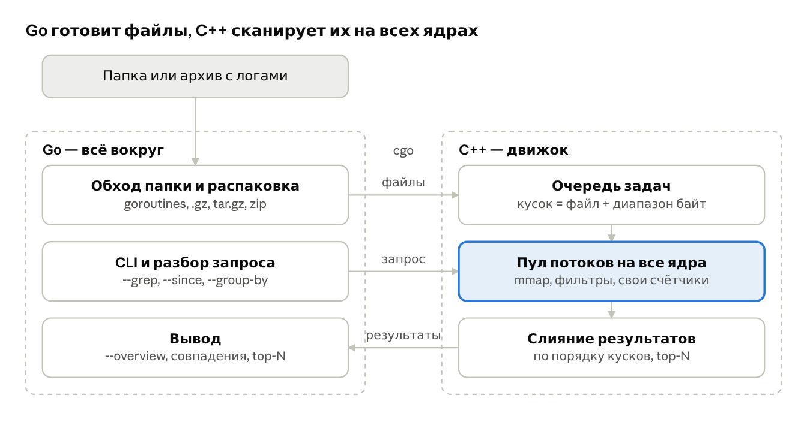

# logq — параллельный анализатор логов

> **Статус:** черновик, ждёт результатов PoC (#6). Решение о теме принимаем в #7.
> Исходный документ: [proposal-original.pdf](proposal-original.pdf).

## Идея

`logq` — консольная утилита для Linux. Она ищет и считает статистику по целой папке логов, используя все ядра процессора. Направляешь её на скачанный архив с конвейера и за секунды видишь, в каких файлах ошибки и что именно сломалось.

**Проблема.** После падения пайплайна скачиваешь архив с сотней логов: мелкие файлы шагов и пара огромных на гигабайты. Дальше вслепую идут `grep -r`, `zcat | grep`, `sort | uniq -c`. При этом один большой файл `grep` читает в одном потоке, а остальные ядра простаивают.

**Решение.** Один инструмент, который сам обходит папку и архивы, режет большие файлы на куски, сканирует всё параллельно и сразу показывает, куда смотреть.

## Как это выглядит

Вывод ниже — иллюстрация замысла, а не реальные замеры.

**1. Обзор: куда смотреть**

```
$ logq build-4812.tar.gz --overview
scanned 137 files, 6.4 GB in 3.1 s (8 threads, 2.1 GB/s)

FILE                           SIZE    LINES   ERROR   WARN   FIRST     LAST
integration-tests/runner.log   3.9 GB  41.2M     312   1840   10:02:11  11:47:30
services/payments.log          1.6 GB  17.0M      57    902   10:01:58  11:47:29
services/gateway.log.gz        410 MB   5.3M       9     44   10:01:58  11:47:30
build/compile.log               12 MB   140K       0      3   09:58:40  10:01:50
... 133 more files without errors (--all to show)
```

Самые подозрительные файлы — сверху.

**2. Поиск по всей папке, как `grep -r`, но на всех ядрах**

```
$ logq ./build-4812/ --grep 'Exception|timeout' -C 1 --since 11:30
services/payments.log
  17: 11:42:07 WARN retrying charge id=8812
  18: 11:42:09 ERROR TimeoutException: db pool exhausted after 30000 ms
  19: 11:42:09 INFO circuit breaker -> OPEN

integration-tests/runner.log
  2210931: 11:42:10 ERROR test_checkout_flow FAILED: upstream timeout

2 files, 58 matches, 1.2 s
```

**3. Агрегация: самые частые ошибки**

```
$ logq ./build-4812/ --level ERROR --group-by message --top 5
COUNT  MESSAGE
  201  TimeoutException: db pool exhausted after <N> ms
   88  test_* FAILED: upstream timeout
   41  connection reset by peer
   23  OutOfMemoryError in worker-<N>
   12  retry budget exceeded
```

**4. Сравнение с привычными инструментами**

```
$ hyperfine 'grep -rc ERROR ./build-4812/' 'logq ./build-4812/ --grep ERROR --count -j 8'
```

## Почему это задача про параллелизм

Вся тяжёлая работа — сканирование байтов, regex, разбор полей, подсчёт — нагружает CPU и делится между ядрами. Мы не просто асинхронно ждём I/O, а реально загружаем все ядра.

**Два уровня параллелизма:**

- **Между файлами:** разные файлы обрабатываются одновременно.
- **Внутри файла:** большой файл отображается в память (`mmap`) и режется на куски по 16–64 МБ. Границы кусков сдвигаются до ближайшего `\n`, и куски сканируются разными потоками.

**Главная сложность — балансировка.** В типичной папке сто файлов по 10 КБ и один на 4 ГБ. Если раздать «по файлу на поток», все потоки быстро закончат мелочь, а один будет долго жевать гигант. Решение: единая очередь задач вида «файл + диапазон байт» и work-stealing.

**Без блокировок в горячем цикле.** У каждого потока свои счётчики и хеш-таблицы, слияние один раз в конце.

**Упорядоченный вывод.** Совпадения в grep-режиме печатаются в исходном порядке, хотя потоки финишируют в разное время. Каждый кусок копит свой буфер, а вывод идёт по номерам кусков.

**Известные ограничения** (тоже пойдут в отчёт):

- Простой поиск подстроки упрётся в пропускную способность памяти уже на 4–6 потоках, а тяжёлый regex масштабируется почти линейно.
- Один `.gz`-файл распаковывается только последовательно, поэтому сжатые файлы параллелятся лишь между собой.
- На холодном page cache всё упирается в диск, на прогретом — в CPU.

## Архитектура

Go-часть отвечает за всё, что связано с файлами и пользователем, C++-движок — за параллельное сканирование. Части общаются через cgo.



Go отдаёт движку сразу пачку файлов одним вызовом. Так C++ сам балансирует куски между потоками, а накладные расходы cgo (~100 нс на вызов) не играют роли.

### Интерфейс Go ↔ C++ (черновик)

Его согласуем первым делом, от него зависят обе части.

```c
// logq_engine.h — граница между Go и C++
typedef struct {
    const char* pattern;        // подстрока или regex
    int          is_regex;
    int64_t      since_ts;      // 0 = без фильтра по времени
    int64_t      until_ts;
    int          context_lines; // -C N
    int          threads;       // 0 = все ядра
} lq_query;

typedef struct lq_result lq_result; // совпадения + счётчики по каждому файлу

// обычные файлы: движок сам делает mmap и нарезку
lq_result* lq_scan_files(const char** paths, int n, const lq_query* q);
// уже распакованный Go буфер (.gz, файл из архива)
lq_result* lq_scan_buffer(const char* name, const char* data, size_t len,
                          const lq_query* q);
void       lq_result_free(lq_result* r);
```

На стороне Go:

```go
res := C.lq_scan_files(cPaths, C.int(len(paths)), &q)
defer C.lq_result_free(res)
printOverview(res) // сортировка файлов по числу ошибок и вывод
```

### Компоненты

| | Go — обвязка | C++ — движок |
|---|---|---|
| **Файлы** | обход папки на goroutines, пропуск бинарников, распознавание `.gz` / `.tar.gz` / `.zip` | `mmap` обычных файлов, нарезка по границам строк |
| **Параллелизм** | параллельная распаковка разных архивов и `.gz` на goroutines | пул потоков, общая очередь задач, work-stealing |
| **Логика** | CLI и разбор запроса (`--grep`, `--since`, `--group-by`) | фильтры (подстрока, regex, диапазон времени), счётчики уровней, group-by, top-N |
| **Вывод** | `--overview` с сортировкой по «подозрительности», таблицы, JSON, цвет | упорядоченные совпадения, контекст `-C N` с учётом стыков кусков |
| **Бонус** | `--follow` как `tail -f`, сравнительная Go-версия сканера | SIMD-поиск, шардированная хеш-таблица для group-by |

Бонус для отчёта: если сделать такой же сканер на чистом Go, можно сравнить масштабирование goroutines и потоков C++ на одной задаче.

## Объём

**MVP:**

- интерфейс Go ↔ C++ и формат результата;
- C++: однопоточный скан через `mmap`, поиск подстроки, подсчёт ERROR/WARN;
- C++: нарезка на куски, пул потоков, общая очередь задач;
- Go: обход папки, CLI, вызов движка через cgo, вывод совпадений по файлам;
- Go: режим `--overview` с сортировкой файлов по числу ошибок;
- C++: упорядоченный вывод и `--group-by`;
- генератор тестовой папки: сотня мелких логов и пара больших файлов;
- бенчмарки и графики.

**Если останется время:** `.gz` и `.tar.gz`, контекст `-C N`, фильтр `--since/--until` через бинарный поиск по времени, общая хронология по всем файлам, `--follow`.

## Как проект закрывает требования курса

| Требование | Чем закрываем |
|---|---|
| Описание задачи, входных и выходных данных, алгоритма | этот документ; вход — папка/архив логов и запрос, выход — совпадения, счётчики, агрегаты |
| Последовательная версия | движок с `threads = 1`: тот же код, один поток |
| Параллельная версия | пул потоков, нарезка файлов, work-stealing |
| Проверка корректности | сравнение вывода параллельной и последовательной версий, сверка с `grep -c` |
| Влияние размера задачи и числа потоков | замеры на разных объёмах данных и на 1, 2, 4, 8… потоках |
| Speedup и efficiency | `Speedup = T_seq / T_par`, `Efficiency = Speedup / P` |
| Анализ: почему ускорение не идеальное, узкие места | упор в память против упора в CPU, закон Амдала, балансировка, page cache |

## Что покажем в отчёте

1. **Масштабирование:** время и ускорение на 1, 2, 4, 8… потоках, сравнение с законом Амдала.
2. **Три стратегии балансировки** на «перекошенной» папке: файл на поток → файлы + нарезка больших → то же с work-stealing.
3. **Упор в память против упора в CPU:** поиск подстроки выходит на плато, тяжёлый regex масштабируется дальше.
4. **Thread-local против общей хеш-таблицы с мьютексом** для `--group-by`: наглядный эффект contention.
5. **Холодный и прогретый page cache** (`echo 3 > /proc/sys/vm/drop_caches`): где узкое место — диск или процессор.
6. **Сравнение с `grep -r`, `rg`, `awk`** через `hyperfine` на одних и тех же данных.
7. **Бонус:** привязка потоков к ядрам (`taskset`) и счётчики `perf stat` (cache misses, миграции потоков).

## Риски и открытые вопросы

Их проверяет PoC (#6):

- **Масштабируется ли скан на нашем железе.** На 4-ядерном ноутбуке реалистичный потолок примерно ×3–3.5, а не ×8. HT для скана памяти почти ничего не добавляет.
- **Влезают ли данные в page cache.** Если тестовые файлы больше свободной RAM, мы мерим диск, а не CPU, и speedup будет около ×1.
- **Где плато у поиска подстроки.** Если оно наступает слишком рано, упор в отчёте нужно делать на CPU-тяжёлые режимы: regex, парсинг, `--group-by`.
- **На какой машине гонять бенчмарки.** Возможно, нужна машина мощнее ноутбука.

## Команда и роли

TODO: распределим на кикофе.
